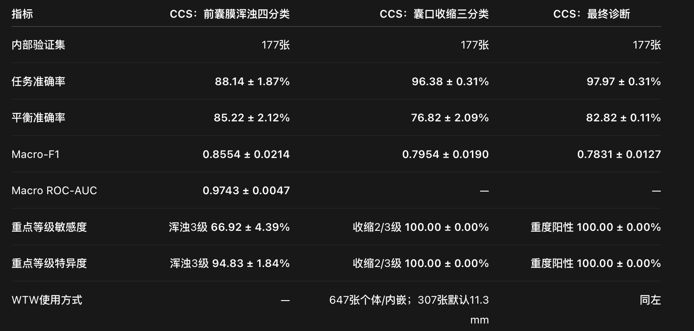

# CCS Reference

[中文说明](README.zh-CN.md)

Reproducibility release for the final reviewed-label CCS development pipeline. The repository follows the research-prototype layout used by [`supdub/vision-ai`](https://github.com/supdub/vision-ai): configuration, installable source, tests, aggregate data, results, tables, figures, and manuscript-facing documentation are kept as separate, auditable artifacts.



## Current Release

The final system uses two stages. Stage 1 is an image-quality gate trained on 1,785 images: 1,164 gradable and 621 ungradable `NA` images. Stage 2 applies opacity grading, opening-area prediction, and the final CCS rule only to images that pass the gate and have reliable grade and area labels.

The current best Stage 2 route uses a frozen ConvNeXt-Tiny image encoder, a regularized four-class anterior-capsule opacity head, a WTW-calibrated opening-area head, deterministic contraction grading, and the final CCS diagnostic rule. The expanded gradable development manifest initially contained 1,471 records. Removing 134 anomalous grouped records and 383 duplicate registrations produced 954 unique gradable images. After blinded review of 23 boundary images, the patient-disjoint cohort contains 777 training images and 177 internal-validation images.

Five matched training runs use seeds `20260927`, `20260928`, `20260929`, `20260930`, and `20261001` on the same fixed split.

| Task | Accuracy | Balanced accuracy | Macro-F1 | Macro ROC-AUC |
|---|---:|---:|---:|---:|
| Anterior-capsule opacity, 4 classes | 88.14 +/- 1.87% | 85.22 +/- 2.12% | 0.8554 +/- 0.0214 | 0.9743 +/- 0.0047 |
| Capsulorhexis contraction, 3 classes | 96.38 +/- 0.31% | 76.82 +/- 2.09% | 0.7954 +/- 0.0190 | Not calculated |
| Final CCS diagnosis, 3 classes | 97.97 +/- 0.31% | 82.82 +/- 0.11% | 0.7831 +/- 0.0127 | Not calculated |

Values are mean +/- sample standard deviation across the five training seeds. The complete machine-readable results are in [`results/multiseed_mean.json`](results/multiseed_mean.json).

## Data Populations

| Route | Gradable | Ungradable NA | Total |
|---|---:|---:|---:|
| Complete quality-gate cohort | 1,164 | 621 | 1,785 |
| Current best grading/area cohort | 954 | 0 | 954 |

NA images contribute to the quality-gate classification loss, but not to the four-class opacity or area-regression losses because they do not have reliable opacity-grade and opening-area labels. See [`tables/quality_gate_distribution.csv`](tables/quality_gate_distribution.csv) for the complete split and [`docs/DATA_FLOW.md`](docs/DATA_FLOW.md) for the relationship between the two cohorts.

## Repository Layout

```text
configs/                 Frozen final-pipeline configuration
data/aggregate/          Non-identifying cohort and split statistics
docs/                    Methods record and aggregate result report
figures/                 Publication-facing aggregate figures
results/                 Five-seed metrics and per-run training histories
src/ccs_model/           Data preparation, training, and evaluation source
tables/                  Manuscript-ready CSV tables
tests/                   Architecture, metric, and threshold tests
```

## Install and Test

Python 3.12 is recommended.

```bash
python -m venv .venv
source .venv/bin/activate
python -m pip install --upgrade pip
python -m pip install -e '.[test]'
pytest
```

## Reproduce the Final Route

The executable stages are:

1. Clean duplicate registrations with `ccs_model.clean_ccs_manifest_v1`.
2. Apply the 23 blinded reviews and rebuild the patient-disjoint split with `ccs_model.apply_reviewed_labels_and_resplit`.
3. Extract frozen ConvNeXt features with `ccs_model.extract_opacity_features_v2`.
4. Train the opacity head with `ccs_model.train_opacity_features_v2`, then apply reviewed-label fine-tuning with `ccs_model.finetune_opacity_head_reviewed_v3`.
5. Train the WTW-calibrated area head with `ccs_model.train_area_features_v1`.
6. Aggregate matched opacity and area runs with `ccs_model.evaluate_multiseed_reviewed_system`.

Exact hyperparameters and seed values are frozen in [`configs/ccs_reviewed_multiseed_v1.yaml`](configs/ccs_reviewed_multiseed_v1.yaml). The repository includes the complete source and aggregate evidence needed to inspect the route; controlled clinical inputs and trained weights are governed separately as described in [`DATA_ACCESS.md`](DATA_ACCESS.md).

## Documentation

- [`docs/METHODS.md`](docs/METHODS.md): manuscript Methods evidence record.
- [`docs/reports/CCS_multiseed_validation_results_20260928.pdf`](docs/reports/CCS_multiseed_validation_results_20260928.pdf): two-page aggregate results report.
- [`tables/final_task_metrics.csv`](tables/final_task_metrics.csv): main manuscript metrics.
- [`tables/per_seed_metrics.csv`](tables/per_seed_metrics.csv): five individual training runs.
- [`tables/cohort_flow.csv`](tables/cohort_flow.csv): cohort and review flow.
- [`tables/quality_gate_distribution.csv`](tables/quality_gate_distribution.csv): gradable/NA quality-gate split.

## Limitations

This release reports development-stage internal validation on 177 images; the locked independent test set was not accessed. The reviewed boundary cases were assigned to training, so the final split differs from the earlier development split. Rare contraction and positive CCS categories have small validation support. Across-seed standard deviations measure optimization stability and are not patient-level 95% confidence intervals.
